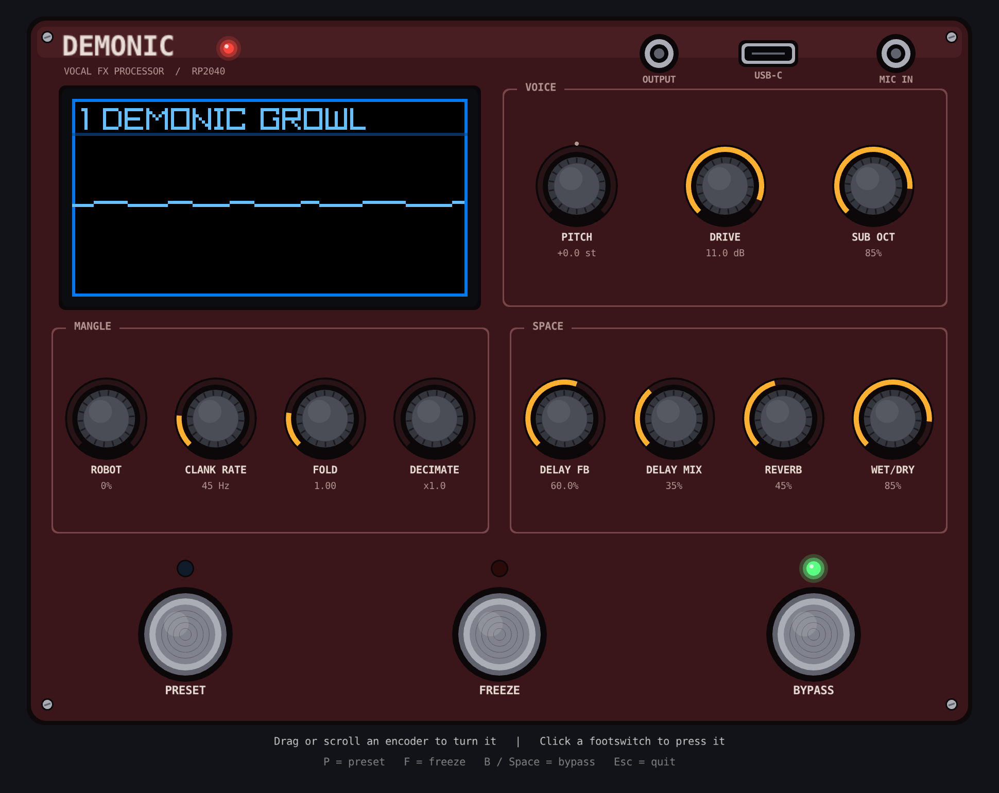

# Vocal FX Processor

A real-time "demonic" vocal effects engine and guitar-pedal-style processor written in C++17.

Talk or sing into a microphone and the engine turns your voice into a pitch-shifted, sub-octave, robotic, bit-crushed, echoing creature. There are two parts: a desktop app that simulates the whole pedal (OLED, encoders, footswitches), and a hardware-agnostic DSP core intended for an Electrosmith Daisy Seed.

<p align="center">
  
</p>

---

## Features

- **Real-time DSP chain** (`DemonicEngine::processBlock`, in this order):
  1. **Noise gate + envelope follower.** Samples below 0.02 (about −34 dBFS) are zeroed, and a smoothed loudness envelope drives later stages.
  2. **Pitch shifter + harmony.** ±1200 cents (±1 octave). A sweeping delay tap plus a second covering tap, crossfaded only around the splice. It is fully skipped at 0 cents and moves formants along with pitch. An optional harmony voice (set by presets, e.g. a fifth above in CYBER DEMON) runs a second sweep over the same buffer, relative to the pitch shift.
  3. **Chorus doubler.** A copy delayed about 10 ms, modulated by a 0.5 Hz LFO, mixed in at 30 %. Always on.
  4. **Sub-octave divider.** A Schmitt-trigger detector on a 2-pole low-passed copy of the voice flips a square wave once per cycle, giving a tone one octave down. It is smoothed and scaled by the voice's loudness.
  5. **Ring modulator ("Robot Clank").** The carrier runs at `robotFreq + 40 × envelope` Hz.
  6. **Drive + wavefolder.** `tanh` saturation followed by a triangle fold.
  7. **Decimator / bit-crusher.** Sample-and-hold by an integer factor, then fixed 32-level quantisation.
  8. **Tone filter.** A fixed one-pole low-pass at about 3 kHz.
  9. **Spectral Freeze.** Loops the last second of the echo input, crossfaded at the loop point so it does not click, mixed 70/30 with the live signal.
  10. **Feedback echo.** ECHO TIME from 20 ms to 2 s (gliding like tape when turned), feedback up to 1.05 (self-oscillation), kept bounded by `tanh` in the loop.
  11. **"Catacomb" reverb.** DaisySP's ReverbSc (a diffuse, modulated 8-line reverb) with a long, dark tail.
  12. **DC blocker**, then the **wet/dry mix**.
- **True bypass.** A 5 ms crossfade, then the output is a bit-for-bit copy of the input. All effect memory (echo and reverb tails, freeze loop, filters) is wiped, so bypass doubles as a panic button for a runaway echo.
- **Simulated pedal (raylib):** the window shows the pedal enclosure: a 128×64 OLED (output waveform, mic level, preset name or the value being turned), 12 endless encoders with LED value rings in VOICE / MANGLE / SPACE panels, PRESET / FREEZE / BYPASS footswitches with LEDs, and top-mounted jacks. Loading a preset turns the encoders to its values. Controls reach the audio thread through `std::atomic` values. Layout and encoder logic are plain headers, tested headlessly.
- **Embedded-minded core:** `float` maths only (no `M_PI` or double literals) and no dynamic allocation. The engine (about 410 KB, with the reverb) goes in fast RAM; its long echo and freeze buffers (`DemonicEngineMemory`, about 576 KB) are passed in, so the Daisy Seed can keep them in SDRAM. Every delay and filter is set in seconds, so it sounds the same at 44.1 kHz (desktop) and 48 kHz (Daisy). Its only dependency is ReverbSc.

### Current limitations

These are tracked in [Developer Guide §10](docs/DEVELOPER_GUIDE.md#10-code-review-known-issues):

- **The board build is a benchmark only** (`daisy/`). There is no audio-capable firmware yet.
- **The harmony voice has no encoder.** Only presets set it (there are no spare pins for a thirteenth encoder).

---

## Signal Flow

```
Mic in
  │
  ▼
[ Noise gate ] ──► envelope follower (feeds sub-octave level and ring-mod rate)
  │
  ▼
[ Pitch shifter ] (+) [ Harmony voice ]   each skipped when off
  │
  ▼
[ Chorus doubler ]  voice + 0.3 × delayed copy
  │
  ▼
  (+) ◄── [ Sub-octave divider ]   detects on the pitch-shifted voice
  │
  ▼
[ Ring modulator ]
  │
  ▼
[ tanh drive ] ─► [ Wavefolder ]
  │
  ▼
[ Decimator + 32-level quantiser ]
  │
  ▼
[ Tone low-pass ~3 kHz ]
  │
  ▼
[ Spectral Freeze loop ]  only while Freeze is on
  │
  ▼
[ Feedback echo 20 ms – 2 s ] ─► records into the Freeze loop
  │
  ▼
[ Catacomb reverb (ReverbSc) ]
  │
  ▼
[ DC blocker ]
  │
  ▼
[ Wet/dry mix ] ─► [ Bypass crossfade ] ─► Speaker out
```

---

## Getting Started

### Prerequisites

- **C++17 compiler:** Apple Clang (Xcode Command Line Tools), GCC or Clang.
- **CMake** 3.18 or newer.
- **PortAudio**, needed for the desktop app only.
- **Internet access** on the first configure, so CMake can download raylib 5.0 and DaisySP (for its ReverbSc). Offline, clone DaisySP with `--recurse-submodules` and configure with `-DFETCHCONTENT_SOURCE_DIR_DAISYSP=/path/to/DaisySP`.

macOS:

```bash
brew install cmake portaudio pkg-config
```

Debian / Ubuntu (the engine and tests are tested on Linux; the desktop app is not):

```bash
sudo apt install build-essential cmake pkg-config portaudio19-dev libasound2-dev libgl1-mesa-dev libx11-dev libxrandr-dev libxinerama-dev libxcursor-dev libxi-dev
```

### Build and run

```bash
cmake -S . -B build          # add -DCMAKE_POLICY_VERSION_MINIMUM=3.5 if CMake 4 complains about raylib
cmake --build build -j4
./build/vocal_desktop
```

> **Use headphones.** With laptop speakers the mic picks up the output and you get feedback howl.

Build options: `-DBUILD_DESKTOP=OFF` builds only the engine and tests (no PortAudio or raylib), `-DBUILD_TESTS=OFF` skips the tests, and `-DUSE_SYSTEM_RAYLIB=ON` uses an installed raylib 5.0+ instead of downloading it.

---

## Controls

| Key / Control | Action |
|---|---|
| **`P`** / PRESET footswitch | Load the next preset (`DEMONIC GROWL`, `MEGATRON`, `CYBER DEMON`); the encoders turn to its values |
| **`F`** / FREEZE footswitch | Toggle Spectral Freeze. This does nothing while bypassed. |
| **`B`** or **`Space`** / BYPASS footswitch | True bypass on/off. This also switches Freeze off. |
| **Mouse drag / scroll on an encoder** | Turn any of the 12 encoders: PITCH, DRIVE, SUB OCT, ROBOT, CLANK RATE, FOLD, DECIMATE, ECHO TIME, DELAY FB, DELAY MIX, REVERB, WET/DRY. Drag round the ring (or up/down from the centre); scroll for single steps. |
| **`Esc`** / close window | Quit |

---

## Tests

The headless DSP test suite runs without audio hardware:

```bash
cmake -S . -B build-tests -DBUILD_DESKTOP=OFF
cmake --build build-tests -j4
ctest --test-dir build-tests --output-on-failure
```

`tests/engine_dsp_test.cpp` measures what comes out of the engine, and should print `ALL TESTS PASSED (0 failures)`. It checks:
- that 48 kHz sounds like 44.1 kHz (echo time, tone filter, pitch, decimation);
- pitch-shifter accuracy on sine and voice-like input, that switching it on or off does not click, and the harmony voice;
- the echo time setting, the freeze loop (1 s, no click at the seam) and the reverb tail;
- sub-octave energy at f/2, and silence in giving silence out;
- that bypass is bit-exact, click-free and clears echo and reverb tails, and that it recovers from a runaway echo (also when released before the long buffers finish clearing).

`tests/engine_smoke_test.cpp` is an **out-of-date** file. It calls engine methods that no longer exist, so it does not compile, and CMake does not build it.

---

## Daisy Seed

`daisy/` cross-compiles a **benchmark** for the Electrosmith Daisy Seed, the target board, with [libDaisy](https://github.com/electro-smith/libDaisy) (and DaisySP's ReverbSc source). It reports how much of the 1,333 µs budget (64 samples at 48 kHz) each block uses. Setup, build and flashing instructions are in the header of [`daisy/Makefile`](daisy/Makefile); [docs/HARDWARE_PLAN.md](docs/HARDWARE_PLAN.md) has the board, pins and parts, and [Developer Guide §11](docs/DEVELOPER_GUIDE.md#11-toward-the-daisy-seed) the budget and what to try if it is too slow. It has not yet been run on hardware.

The benchmark for the previous board, the WeAct RP2350B Core (`pico/`), was removed when the engine outgrew its 520 KB of RAM; it is in the git history.

## Third-party code

The reverb is **ReverbSc** from Electrosmith's [DaisySP-LGPL](https://github.com/electro-smith/DaisySP-LGPL), licensed **LGPL-2.1** (the rest of DaisySP is MIT). It is downloaded at build time, not copied into this repository, and compiled into the desktop app and the firmware. That is fine for personal use. If you distribute firmware or pedals, the LGPL requires that users can relink the firmware with a modified ReverbSc; DaisySP-LGPL's `distribution/gather_lgpl.sh` packages the object files for that.
---

## Repository Structure

```
vocal-fx-processor/
├── CMakeLists.txt              Desktop/test build: demonic_engine library, engine_dsp_test, sim_controls_test, hw_pinout_test, vocal_desktop
├── README.md                   This file
├── AGENTS.md                   Instructions for coding agents (CLAUDE.md is a symlink to it)
├── docs/
│   ├── USER_GUIDE.md           End-user guide: controls, parameters, presets, recipes, troubleshooting
│   ├── DEVELOPER_GUIDE.md      Architecture, stage-by-stage DSP walkthrough, C++ primer, known issues, Daisy Seed port notes
│   └── HARDWARE_PLAN.md        Board choice (Daisy Seed), audio design, pin map, shopping list, next steps
├── include/
│   ├── demonic_engine.hpp      DemonicEngine class, DemonicEngineMemory (long buffers) and VocalPreset struct
│   ├── sim_controls.hpp        Simulator encoders: ranges, steps, display, preset values
│   ├── sim_layout.hpp          Simulator enclosure geometry, hit-testing, knob dragging
│   ├── hw_pinout.hpp           Planned hardware pin map (Daisy Seed)
│   ├── engine_bench.hpp        Benchmark scenarios and timing loop for daisy/
│   ├── sim_font.hpp            Embedded DejaVu Sans Mono for the simulator
│   └── dsp_pipeline.hpp        Empty placeholder (not used)
├── src/
│   ├── demonic_engine.cpp      The whole DSP engine (standard library, plus DaisySP's ReverbSc)
│   └── dsp_pipeline.cpp        Empty placeholder (not used)
├── desktop/
│   └── main_desktop.cpp        Desktop app: PortAudio callback + raylib pedal simulator
├── tests/
│   ├── engine_dsp_test.cpp     Frequency-measuring DSP tests (registered with ctest)
│   ├── sim_controls_test.cpp   Simulator layout and encoder tests (registered with ctest)
│   ├── hw_pinout_test.cpp      Planned pin map checks (registered with ctest)
│   ├── test_engine.hpp         TestEngine: an engine plus its memory, on the heap, for the tests
│   └── engine_smoke_test.cpp   Out of date; not built
├── daisy/
│   ├── Makefile                Separate libDaisy build (setup notes in its header)
│   └── main_daisy.cpp          Daisy Seed real-time budget benchmark
├── cmake/version.cmake         Version number from the latest v* git tag
├── .github/                    Release workflow: tags and publishes a GitHub Release on every merge to main
├── .agents/skills/vocal-fx-processor/   Agent runbook, references and build scripts
└── portaudio/                  Optional vendored PortAudio source (git-ignored; last-resort fallback)
```

---

## Documentation

- **[docs/USER_GUIDE.md](docs/USER_GUIDE.md):** using the pedal: controls, every encoder, presets, Freeze, Bypass, sound recipes, troubleshooting.
- **[docs/DEVELOPER_GUIDE.md](docs/DEVELOPER_GUIDE.md):** how the code works, written for Python programmers new to C++. It covers threads and atomics, each DSP stage, the build system, how to extend the engine, tests, known issues and the Daisy Seed port.
- **[docs/HARDWARE_PLAN.md](docs/HARDWARE_PLAN.md):** the planned hardware pedal: why the Daisy Seed 65MB, the audio path and mic preamp, firmware layout and latency, the pin map, what to buy, and next steps.
- **[Releases](https://github.com/wsjk/-vocal-fx-processor/releases):** the changelog. Every merge to `main` is tagged and released, and the notes list the merged PRs. The version shows in the simulator's title bar and the Daisy benchmark's output.
